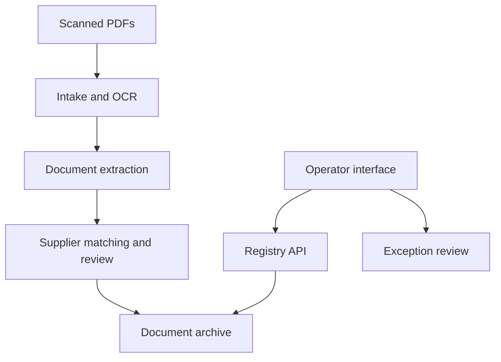

# Scanners — Delivery Note Processing and Archiving — Architecture

Administrative teams can process batches of scanned delivery notes without manually separating every PDF and filing every document. Automated extraction is paired with a review workflow for uncertain supplier matches, duplicates and documents requiring correction.

## Components

| Component | Responsibility |
|---|---|
| Processing backend | Python ingestion, OCR, extraction and document-classification services. |
| Registry API | FastAPI access to document records, operations and administration. |
| Registry interface | React/TypeScript browsing, search, review and settings screens. |
| Document storage | Private PDFs, processing outputs and supplier-organized archive locations. |
| Extraction adapters | Tesseract and server-side AI integration. |

## Main interactions

## Responsibility boundaries

- Uncertain extraction enters a review path. Operators can distinguish verified filing from results that still need attention.
- Separate document processing from archive interaction. Users can consult the archive while background intake continues.
- Make destructive operations explicit. Operators can inspect the intended scope before changing archive contents.

## Constraints

OCR and extracted information can be incomplete or incorrect. Review queues and access-controlled document operations remain necessary.

## Technology

Python, FastAPI, React, TypeScript, Tesseract OCR, model-assisted extraction and Docker.
